# 01 — Business process (As-Is / To-Be)

Collaborations คือหน้าจดไอเดียงานร่วม (field folio) ที่เก็บโน้ตใน localStorage ของเบราว์เซอร์ ผู้เยี่ยมชมเพิ่มโน้ตพร้อมสถานะ (Draft, Open, Active, Done) ค้นหา และลบได้ ไม่มี backend บัญชี หรือการจับคู่ทักษะ และ `/api/mcp` ตอบได้เฉพาะ initialize กับรายการ tool ที่ว่าง

Last reviewed: 2026-11-28 · commit `5547f3c`

## As-Is (จากโค้ดวันนี้)

```mermaid
flowchart LR
  PUSH["push to main"] --> CI["CI: shared Node workflow + security scan"]
  PUSH -->|"Vercel Git link deploys main, verified 2026-11-28"| VERCEL["Vercel project"]
  VERCEL -->|"production = main HEAD 5744e43, latest deploy via Vercel CLI, verified 2026-11-28"| SITE["live site"]
  SITE --> PAGE["app/page.tsx client page, as in main"]
  PAGE --> LOAD{"localStorage collabs-v1 readable and valid?"}
  LOAD -->|"no, bad JSON or blocked"| SEED["2 sample notes"]
  LOAD -->|yes| LIST["saved notes via parseNotes, wrong-shape dropped"]
  SEED --> VIEW["search title, details, status; header counts living threads"]
  LIST --> VIEW
  VIEW --> ADD{"title filled?"}
  ADD -->|no| NOOP["list unchanged, nothing written"]
  ADD -->|yes| ADDN["new note planted on top"]
  ADDN --> WRITE["noteStore.update: save notes"]
  VIEW --> RM["Remove, toast with Undo: restoreNote"]
  RM --> DEL["remove: saved notes minus this note"]
  DEL --> WRITE
  DEL --> UNDO["Undo in toast: restoreNote puts it back before its old neighbour"]
  UNDO --> WRITE
  WRITE -->|"localStorage write ok"| TABS["storage event refreshes other tabs"]
  WRITE -->|"storage blocked or full"| MEM["kept in memory for this tab only, no storage event"]
  SRV["server request error: instrumentation onRequestError"] -. "only if DSN set, same scrub" .-> SENTRY
  PAGE -. "error, only if NEXT_PUBLIC_SENTRY_DSN set" .-> SENTRY["Sentry, errors only: beforeSend drops request, user, breadcrumbs, extra, stack vars and URL queries"]
  MCPCALL["MCP client POST /api/mcp"] --> MCP{"method"}
  MCP -->|"initialize, tools/list"| EMPTY["answers, tool list is empty"]
  MCP -->|"tools/call, unknown method, bad JSON"| RPCERR["JSON-RPC error, HTTP 400"]
```

Sources: `app/page.tsx`, `lib/collaborations.ts`, `app/api/mcp/route.ts`, `lib/sentry.ts`, `PRODUCT.md`

ข้อเท็จจริงสำคัญจากโค้ด:

- แก้โน้ตหลังเพิ่ม ซิงก์ข้ามอุปกรณ์ และ export ทำไม่ได้ (`PRODUCT.md`)
- ไม่มีการจับคู่ทักษะ ฟอร์มข้อเสนอ หรือคำเชิญ
- ข้อยกเว้นของ "อยู่ในเบราว์เซอร์เท่านั้น": ถ้าตั้ง `NEXT_PUBLIC_SENTRY_DSN` รายงานข้อผิดพลาดที่ผ่าน `scrubEvent` ใน `lib/sentry.ts` จะถูกส่งไป Sentry; ไม่ส่ง tracing หรือ replay

## To-Be

ไม่มี To-Be ที่เขียนไว้ สำหรับกระบวนการของแอป (`PRODUCT.md` ระบุเฉพาะสิ่งที่ไม่ทำ และเป้าหมาย deploy ผ่าน Vercel Git ซึ่งทำแล้ว ดูตาราง Gap)

## Gap

| ID | As-Is → To-Be | Status | Owner | Evidence |
|---|---|---|---|---|
| G1 | push ไป main ไม่ deploy (Vercel link ชี้ repo เดิม deploy ด้วย CLI) → Vercel Git เชื่อม repo นี้ push แล้ว deploy | done | owner | `PRODUCT.md` §Live URL and deploy state (owner action D9, เขียนไว้ 2026-10-23); Vercel API 2026-11-28: project `bookchaowalit-collaborations-frontend` Git link → `bookchaowalit-website/community-collaborations-web`, production branch `main` |
| G2 | ไม่มี To-Be ของกระบวนการ (ฟีเจอร์ใหม่ เช่น เก็บข้อมูลฝั่ง server) → owner กำหนดหรือยืนยันว่าคงเป็นเดโมในเบราว์เซอร์ | decide | owner | ไม่มีใน `PRODUCT.md` ส่วน What does not work |

## Open questions

- เรื่อง deploy ไม่มีคำถามค้าง: Vercel Git link ชี้ repo นี้ branch `main` (ตรวจ 2026-11-28) production = main HEAD 5744e43
