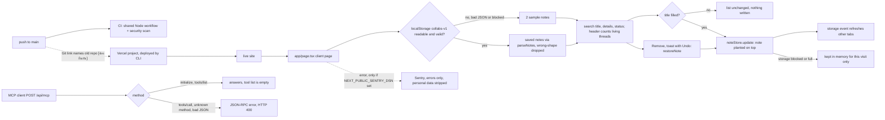

# 01 — Business process (As-Is / To-Be)

Collaborations คือหน้าจดไอเดียงานร่วม (field folio) ที่เก็บโน้ตใน localStorage ของเบราว์เซอร์ ผู้เยี่ยมชมเพิ่มโน้ตพร้อมสถานะ (Draft, Open, Active, Done) ค้นหา และลบได้ ไม่มี backend บัญชี หรือการจับคู่ทักษะ และ `/api/mcp` ตอบได้เฉพาะ initialize กับรายการ tool ที่ว่าง

Last reviewed: 2026-11-28 · commit `5547f3c`

## As-Is (จากโค้ดวันนี้)

Sources: `app/page.tsx`, `lib/collaborations.ts`, `app/api/mcp/route.ts`, `lib/sentry.ts`, `PRODUCT.md`

ข้อเท็จจริงสำคัญจากโค้ด:

- แก้โน้ตหลังเพิ่ม ซิงก์ข้ามอุปกรณ์ และ export ทำไม่ได้ (`PRODUCT.md`)
- ไม่มีการจับคู่ทักษะ ฟอร์มข้อเสนอ หรือคำเชิญ

## To-Be

ไม่มี To-Be ที่เขียนไว้ สำหรับกระบวนการของแอป (`PRODUCT.md` ระบุเฉพาะสิ่งที่ไม่ทำ และเป้าหมาย deploy ผ่าน Vercel Git ซึ่งอยู่ในตาราง Gap)

## Gap

| ID | As-Is → To-Be | Status | Owner | Evidence |
|---|---|---|---|---|
| G1 | push ไป main ไม่ deploy (Vercel link ชี้ repo เดิม deploy ด้วย CLI) → Vercel Git เชื่อม repo นี้ push แล้ว deploy | decide | owner | `PRODUCT.md` §Live URL and deploy state (owner action D9, เขียนไว้ 2026-10-23) |
| G2 | ไม่มี To-Be ของกระบวนการ (ฟีเจอร์ใหม่ เช่น เก็บข้อมูลฝั่ง server) → owner กำหนดหรือยืนยันว่าคงเป็นเดโมในเบราว์เซอร์ | decide | owner | ไม่มีใน `PRODUCT.md` ส่วน What does not work |

## Open questions

- สถานะ Vercel Git link ปัจจุบัน [ต้องยืนยัน]: `PRODUCT.md` เขียนไว้ 2026-10-23 ว่า push ไป main ไม่ deploy; ตรวจที่ Vercel ก่อนเชื่อว่ายังเป็นจริง
